<picture>
  <source media="(prefers-color-scheme: dark)" srcset="assets/worldmap-dark.svg">
  
</picture>

<h3 align="center">AI 팀을 꾸려 도구를 만들고, 그 팀과 함께 게임을 만들고 있습니다</h3>

From physics through robots and vision AI — now running a team of AI agents and building a small game with it.

<picture>
  <source media="(prefers-color-scheme: dark)" srcset="assets/header-current-quest-dark.svg">
  
</picture>

- **AI 팀 운영** · Claude, Codex, Gemini가 기억을 나누며 함께 일하는 작업 환경을 설계하고 운영합니다. 방향을 정하고 결과를 검토하는 것이 제 몫입니다.
- **AI에게 눈과 귀 달아 주기** · 영상의 장면과 움직임, 음악의 박자와 코드와 가사를 AI가 읽을 수 있게 바꿔 주는 분석 도구를 팀과 함께 만듭니다.
- **작은 게임** · 이 팀과 함께 만드는 첫 게임입니다. 완성되면 지도의 안개가 걷힙니다.

<picture>
  <source media="(prefers-color-scheme: dark)" srcset="assets/header-quest-log-dark.svg">
  
</picture>

<b>01 물리 연구소</b> · 물리학 학사, 양자광학 대학원 과정

대학원에서 NV센터 다이아몬드를 이용한 온도 센싱을 시뮬레이션으로 연구했습니다.

<b>02 로봇 공방</b> · 로봇 연동과 초기 구동

- ROS 기반 AMR에 외부 시스템의 이동 명령을 소켓으로 전달
- 로봇팔 제어용 gRPC 통신 시험, 로봇팔 카메라 영상 연결
- 장비가 오기 전 Qt로 FK/IK 시뮬레이션, Pico에서 PID 구동 시험
- [dobot](https://github.com/Song-Seng-Hun/dobot) · YOLO로 블록의 색과 모양을 인식하는 로봇팔 프로젝트
- [my_custom_stt_train](https://github.com/Song-Seng-Hun/my_custom_stt_train) · 한국어 음성인식(KoSpeech) 학습 환경

<b>03 비전 데이터 공장</b> · 이미지 분류 모델 학습과 운영, 약 2년

- EfficientNet 기반 분류 모델을 고객 데이터에 맞춰 학습하고 오분류 샘플 분석
- 데이터 검수와 정제를 반복 진행하고, 검수 인력에게 작업을 나눠 전달
- Streamlit 검수 도구, Label Studio 모델 보조 라벨링 프로토타입(Jetson 추론 서버 + FastAPI)
- YOLO 예측을 초벌 라벨로 쓰는 라벨링 파이프라인
- 배운 점: 모델 구조만큼 데이터의 상태와 촬영 조건이 결과를 좌우했습니다.

<b>04 감각 연구소</b> · AI의 눈과 귀

영상은 장면 전환과 움직임으로, 음악은 박자와 코드와 가사로 정리해서 AI가 읽을 수 있는 리포트를 만드는 도구입니다. (비공개)

<b>05 AI 팀 본부</b> · 여러 AI가 함께 일하는 작업 환경

공유 기억 문서와 작업 일지를 두고 Claude, Codex, Gemini가 역할을 나눠 일합니다. 사람은 방향을 정하고 결과를 확인합니다. (비공개)

<b>06 게임 마을</b> · 제작 중

AI 팀과 함께 만드는 작은 게임입니다. *To be continued.*

<picture>
  <source media="(prefers-color-scheme: dark)" srcset="assets/header-inventory-dark.svg">
  
</picture>

| 분야 | 써 본 것 |
|---|---|
| 비전과 데이터 | PyTorch · EfficientNet · YOLO · OpenCV · Streamlit · Label Studio · FastAPI |
| 로봇 | ROS · gRPC · Qt · Raspberry Pi Pico |
| 언어 | Python · C++ · C |
| AI 협업 | Claude Code · Codex · Gemini |
| 창작 | Clip Studio Paint · After Effects · Reaper |

지도와 픽셀 제목은 Claude가 그렸습니다 ([tools/build_worldmap.py](tools/build_worldmap.py)).
